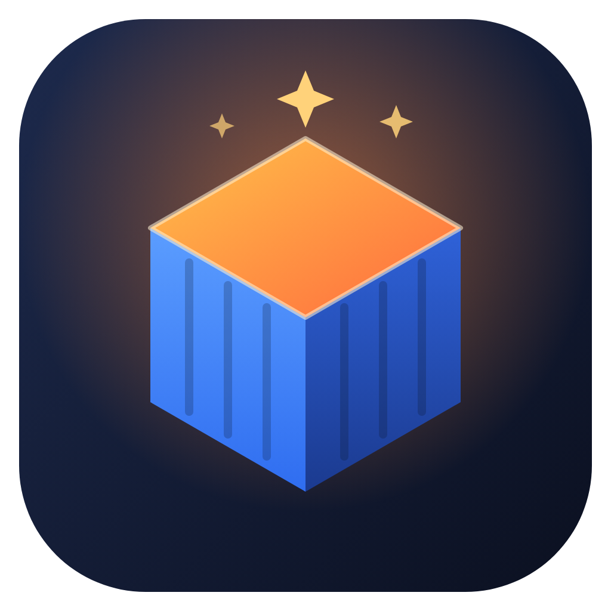

<p align="center"></p>

# BoxForge

Docker를 쉽게, 눈으로 보면서 쓰기 위한 앱입니다. 데스크톱 앱(Windows · Linux · macOS)으로 쓰거나, 서버에 켜 두고 휴대폰 · 다른 PC의 브라우저로 씁니다.

- **무료 엔진만 씁니다.** Docker Desktop이 필요 없습니다. Docker Engine이 없으면 BoxForge가 설치해 줍니다.
- **쉬운 말로 안내합니다.** 버튼마다 무슨 일이 생기는지, 왜 멈췄는지 알려 줍니다.
- **명령도 함께 보여 줍니다.** 화면에서 한 모든 일은 같은 일을 하는 `docker` 명령으로 하단에 나옵니다.
- **Docker만이 아닙니다.** Podman, containerd(nerdctl), 다른 PC의 엔진(SSH), 연습용 Kubernetes도 같은 화면으로 다룹니다.

## 설치

[릴리스 페이지](https://github.com/soulfactorx/BoxForge/releases/latest)에서 내려받습니다. 설치 과정은 없습니다. 받은 파일을 원하는 폴더에 두고 실행하면 되고, 이후에는 새 버전이 나오면 앱이 알아서 받아 둡니다.

| 쓰는 곳 | 파일 |
|---|---|
| Windows 10 · 11 | `BoxForge-windows-amd64.exe` |
| Linux 데스크톱 (Ubuntu 24.04 등) | `BoxForge-linux-amd64` |
| macOS (Intel · Apple 칩) | `BoxForge-macos.zip` |
| 서버 — 브라우저로 접속 | `BoxForge-server-linux-amd64`, `BoxForge-server-linux-arm64`, `BoxForge-server-windows-amd64.exe` |

**Windows**: 처음 실행할 때 "Windows의 PC 보호" 창이 뜰 수 있습니다. 프로그램에 유료 코드 서명이 없어서 그렇습니다. "추가 정보" → "실행"을 누르면 됩니다.

**Linux 데스크톱**: 실행 권한을 주고, WebKitGTK 4.1이 있어야 합니다. 처음 실행할 때 앱 메뉴에 등록되어 창과 작업 표시줄에 아이콘이 나옵니다.

```bash
chmod +x BoxForge-linux-amd64
```

```bash
sudo apt install libwebkit2gtk-4.1-0
```

**macOS**: 압축을 풀어 응용 프로그램 폴더로 옮깁니다. Apple에 등록된 서명이 없어 처음에는 열리지 않으니, 앱을 우클릭 → "열기"를 누르거나 아래를 한 번 실행합니다. 엔진은 [Colima](https://github.com/abiosoft/colima)를 씁니다(`brew install colima docker && colima start`). macOS 판은 아직 실제 Mac에서 충분히 써 보지 못했습니다.

```bash
xattr -dr com.apple.quarantine /Applications/BoxForge.app
```

**서버**: 창이 없는 기기(집 서버, NAS, 라즈베리 파이, Alpine 등)에서는 서버용 파일을 켜 두고 브라우저로 접속합니다. 다른 라이브러리가 필요 없습니다. 로그인한 사람은 그 기기를 마음대로 다룰 수 있으니 [docs/SERVER.md](docs/SERVER.md)를 먼저 읽어 주세요.

```bash
./BoxForge-server-linux-amd64 -listen :8088 -tls          # 지금 이 터미널에서
./BoxForge-server-linux-amd64 -daemon -listen :8088 -tls  # 백그라운드로 (-stop 으로 끄기)
sudo ./BoxForge-server-linux-amd64 -install               # 서비스로 설치: 컴퓨터를 켤 때마다 시작
./BoxForge-server-linux-amd64 -update                     # 새 버전으로 바꾸고 돌던 서버를 다시 켬
```

## 처음 켜면

1. 홈 화면이 뜹니다. 엔진에 연결되어 있지 않으면 **"엔진 설치 · 선택"** 버튼이 보입니다.
2. Docker Engine이 없다면 "Docker Engine 설치"를 누릅니다.
   - **Windows**: WSL 2 준비 → Linux 내려받기(Ubuntu · Debian · Alpine 중 선택) → Docker 설치까지 알아서 합니다. 관리자 권한을 한 번 묻고, Windows를 다시 시작해야 할 수 있습니다.
   - **Linux**: 배포판의 패키지 관리자로 설치합니다. 관리자 비밀번호를 한 번 묻고, 끝난 뒤 한 번 로그아웃했다가 다시 로그인해야 할 수 있습니다.
   - **macOS**: Homebrew로 Colima를 설치하고 켭니다. Homebrew가 먼저 있어야 합니다.
3. 홈의 "바로 실행하기"에서 PostgreSQL이나 nginx를 눌러 첫 컨테이너를 실행해 보세요.

이미 엔진이 있으면 그대로 연결됩니다. 여러 엔진이 있으면 사이드바의 엔진 카드에서 고릅니다.

## 쓸 수 있는 엔진

| 엔진 | 조건 |
|---|---|
| Docker Engine | 이 PC의 것, 또는 Windows의 WSL 배포판 안의 것. 없으면 BoxForge가 설치 |
| 다른 Docker 호환 엔진 | Kiri, Colima, Rancher Desktop 등 Docker context로 등록된 것 |
| 다른 PC · 서버의 Docker | 엔진 선택 창에서 `user@host`를 추가. SSH 키 로그인이 되어 있어야 함 |
| Podman (실험적) | 설치되어 있으면 목록에 나옴. 고르면 BoxForge가 Podman의 API를 켜서 연결 |
| containerd (실험적) | Docker 없이 containerd만 있을 때. `nerdctl`이 있어야 함. 실행 중인 컨테이너의 네트워크 연결 · 해제는 안 됨 |

엔진 사이에 이미지 · 볼륨 · 컨테이너를 복사할 수 있습니다. Docker Desktop은 유료라서 쓰지 않으며 목록에서도 뺍니다.

## 할 수 있는 일

| 화면 | 내용 |
|---|---|
| 홈 | 실행 중인 것, 자주 쓰는 프로그램 바로 실행, 실패한 컨테이너와 이유, 디스크 정리(BoxForge가 남긴 이미지 포함), 용어 설명 |
| 공통 | 모든 목록은 엔진의 알림으로 바로 바뀌며, 앱 이름 옆 버튼으로 직접 새로 고칠 수도 있습니다 |
| 컨테이너 | 시작 · 중지 · 재시작 · 이름 변경 · 삭제(여러 개 골라 한 번에도: 이미지 · 볼륨 · 네트워크 목록도 같음), 실시간 로그(오류 · 경고 등 수준 골라 보기), 터미널(앱 안 · 외부, 오른쪽 클릭으로 복사 · 붙여넣기, 휴대폰용 특수 키 막대: 방향키 · Tab · Ctrl · Alt · F1~F12, 손가락 스크롤, 지난 출력까지 글로 보고 골라 복사), CPU · 메모리 · 네트워크 그래프, 안에서 도는 프로세스, 상세 정보 복사, 환경변수 고치기, 자원 제한 바꾸기, 상태 검사 표시, 실패 알림, 안의 파일 보기 · 올리기, 멈춘 이유 설명, 설정 바꿔 다시 만들기, 다른 엔진으로 복사, 파일로 내보내기 · 가져오기(Compose 프로젝트 통째로: 연결한 폴더 · Compose 파일 · 네트워크 · 고정 IP · MAC 주소 유지, 가져온 뒤 순서대로 시작) |
| Compose | 새 프로젝트 만들기(시작용 파일 제공), 프로젝트 올리기 · 내리기, 구조 그림과 그림에서 서비스 고치기 · 추가 · 삭제 · 선을 끌어 잇기(depends_on), 서비스별 조작, 파일 편집과 적용 미리 보기(리눅스의 Docker에서 `host.docker.internal`로 같은 프로젝트의 서비스에 연결하면 알리고 별칭으로 고쳐 줌), 로그 |
| 관계도 | 포트 · 컨테이너 · 네트워크 · 볼륨의 관계를 한 그림으로 |
| 이미지 | 받기, Docker Hub에서 찾기, 태그, 레지스트리에 올리기(push), 이름을 누르면 레이어(만든 단계) · 정보 보기, 삭제, 정리, 바로 실행, 다른 엔진으로 복사 |
| 볼륨 | 만들기, 삭제, 정리, 안에 든 파일 보기 · 내려받기 · 올리기, 다른 엔진으로 복사 |
| 네트워크 | 만들기, 컨테이너 연결 · 해제, 삭제 |
| 빌드 | Dockerfile로 이미지 만들기, 단계별 진행, 설정 저장 |
| Kubernetes | 컨테이너 하나로 도는 연습용 클러스터(k3s), 앱 배포 도우미(이미지 → Deployment · Service · Ingress · 저장소)와 배포 진행 표시, 배포된 것 YAML로 고치기, 엔진의 이미지를 클러스터에 넣기, 컨테이너 메뉴에서 "Kubernetes로 배포", Compose 프로젝트 통째로 옮기기(볼륨 데이터 복사, MAC 주소 · hostname 유지, 서비스 이름으로 모든 포트)와 통째로 지우기 · 연결 점검 · 로그 모아 보기, 흐름 그림(주소 → 서비스 → 워크로드 → 파드)과 막힌 곳의 원인, 파드 · 워크로드 · 서비스 · 주소(Ingress) · 설정값(ConfigMap · Secret) · 저장소(PVC), 파드 터미널, 서비스와 주소를 내 PC 포트로 연결, YAML 적용 |
| AI 에이전트 | Pi Coding Agent · Claude Code · Codex · Gemini CLI · Copilot CLI · Cursor CLI · Grok CLI · OpenClaw · Hermes Agent(또는 내 이미지)를 격리된 상자에서 실행: 작업 폴더 하나만, 관리자 아닌 사용자, 특권 없음, CPU · 메모리 · 프로세스 한도, 네트워크는 "AI 서비스만"(허용한 주소만 통과시키고 모든 연결을 기록) · 인터넷 전체 · 끊김 중에서. 제어판: 터미널(에이전트 · 셸을 편집기처럼 탭으로 여럿 열고 닫기, 높이 조절 · 크게 보기), 바뀐 파일과 차이, 연결 기록(막힌 주소 바로 허용), 작업 폴더 저장 · 되돌리기, API 키(컨테이너 설정에 나오지 않는 파일로), 늘 켜 두기(OpenClaw 게이트웨이 등), 포트를 다시 만들지 않고 바로 열기 · 닫기, OpenClaw 화면을 로그인된 링크로 내 PC 브라우저나 브라우저 상자(격리된 Firefox)에서 열기(웹 서버로 접속하면 서버의 HTTPS로, 로그인한 브라우저에만 열어 다른 기기에서도), 에이전트 업데이트 |
| 설정 | 언어(한국어 · English), 테마, 트레이, 로그인할 때 시작, 실패 알림, 자동 업데이트, 엔진, 엔진 자원(WSL의 메모리 · CPU, 디스크 자동 줄이기), WSL 가상 디스크 줄이기(BoxForge · Kiri 등 배포판마다), 회사 네트워크(프록시 · 인증서), 레지스트리 로그인 |

- **찾기**: `Ctrl+K`를 누르면 어디서든 화면 · 컨테이너 · 이미지를 찾아 이동합니다. 인터넷에서 본 `docker run …` 명령을 붙여넣으면 실행 창에 풀어서 채워 줍니다.
- **내보내기 · 가져오기**: 컨테이너를 이미지 · 볼륨 데이터 · 설정과 함께 `.boxforge` 파일 하나로 내보내 동료에게 주거나 다른 PC로 옮깁니다. Docker와 containerd 사이에서도 오갑니다.
- **설정 바꿔 다시 만들기**: 포트 · 저장 공간 · 환경변수 · 네트워크는 컨테이너를 만들 때만 정할 수 있습니다. 지금 설정에서 고쳐 같은 이름으로 다시 만들고, 실패하면 원래 것을 되돌립니다.
- **alpine · ubuntu 같은 기본 이미지**: 셸만 실행하는 이미지는 그냥 실행하면 바로 꺼집니다. BoxForge는 이런 이미지를 터미널을 연 채로 켜 두어 "터미널" 탭에서 쓸 수 있게 합니다.

## 알아 둘 것

- **회사 PC**: BIOS에서 가상화가 꺼져 있거나 WSL이 정책으로 막혀 있으면 엔진을 설치할 수 없습니다. IT 부서에 "WSL 2 사용"을 요청해야 합니다.
- **회사 프록시 · 사내 인증서**: 설정 → 회사 네트워크에서 넣습니다. BoxForge가 설치한 WSL 엔진과 BoxForge의 Kubernetes 클러스터에 적용됩니다.
- **비공개 레지스트리**: 설정 → 레지스트리 로그인. PC에 `docker` 명령이 있어야 합니다.
- **Compose · 빌드**: PC(또는 엔진이 있는 WSL 배포판)의 `docker` 명령으로 실행합니다. BoxForge가 설치한 엔진에는 들어 있습니다.
- **엔진 유지 (Windows)**: BoxForge가 설치한 엔진은 앱이 켜져 있는 동안 돕니다. 설정 → "앱을 닫아도 엔진 유지"를 켜면 앱을 닫아도 컨테이너가 계속 돕니다. "로그인할 때 BoxForge 시작"을 켜면 PC를 켤 때 트레이로 시작해 엔진도 함께 켜집니다.
- **엔진 자원 (Windows)**: 설정 → 엔진 자원에서 WSL이 쓸 메모리 · CPU를 정합니다. WSL 전체에 적용되고, 바로 적용하면 모든 WSL 배포판이 잠깐 멈춥니다.
- **트레이**: 창을 닫아도 트레이 아이콘으로 남아 계속 실행됩니다(설정 → 화면에서 끌 수 있음). 트레이 메뉴의 "업데이트 확인"으로 창을 열지 않고도 새 버전을 받아 설치하고, 한 번 더 누르면 새 버전으로 다시 시작합니다. GNOME은 "AppIndicator" 확장이 있어야 트레이가 보이며, 없으면 닫을 때 그냥 꺼집니다. macOS에는 트레이가 없습니다.
- **내보낸 파일**: 환경변수(비밀번호 포함)와 볼륨 데이터가 그대로 들어갑니다. 건넬 때 주의하고, 모르는 사람이 준 파일은 가져오지 마세요.
- **개인 정보**: 사용 정보를 어디에도 보내지 않습니다. 스스로 접속하는 곳은 업데이트 확인(GitHub)뿐이고, "Docker Hub에서 찾기"를 쓰면 그 검색어가 Docker Hub로 갑니다.
- **확인이 덜 된 곳**: macOS 판과 macOS · Linux의 엔진 자동 설치, Podman · containerd(실험적), Windows · ARM용 서버, 영어 화면의 문구. 문제가 있으면 알려 주세요.

문제가 있으면 [이슈](https://github.com/soulfactorx/BoxForge/issues)로 알려 주세요. 하단의 "기록"에 나오는 명령과 오류 문구를 함께 적어 주시면 빨리 찾을 수 있습니다.

## 개발

필요한 것: Go, Node.js 22, [Wails](https://wails.io) v2 (`go install github.com/wailsapp/wails/v2/cmd/wails@v2.17.1`). Linux는 `libgtk-3-dev`, `libwebkit2gtk-4.1-dev`.

```bash
wails build                    # Windows · macOS
```

```bash
wails build -tags webkit2_41   # Linux
```

화면 파일을 먼저 빌드합니다(Go 프로그램들이 이것을 실행 파일 안에 넣습니다).

```bash
cd frontend && npm install && npm run build && cd ..
```

데스크톱 창 없이 브라우저로 화면을 띄우려면(개발용, 로그인 없음, 127.0.0.1에만 열림):

```bash
go run ./cmd/devserver
```

Docker가 없는 PC에서는 `BOXFORGE_ENGINE=fake go run ./cmd/devserver`.

웹 서버는 창 라이브러리 없이 빌드됩니다.

```bash
CGO_ENABLED=0 go build -o boxforge-server ./cmd/boxforge-server
```

검사:

```bash
gofmt -l . && go vet ./internal/... ./cmd/... ./frontend . && go test ./internal/...
```

- 설계: [docs/DESIGN.md](docs/DESIGN.md)
- 웹 서버로 쓰기: [docs/SERVER.md](docs/SERVER.md)
- 릴리스 내는 법: [docs/RELEASING.md](docs/RELEASING.md)
- 바뀐 내용: [CHANGELOG.md](CHANGELOG.md)

## 라이선스

[Apache License 2.0](LICENSE).

제품 아이콘은 [Simple Icons](https://simpleicons.org)(CC0)의 것이며, 각 상표는 해당 소유자의 것입니다.
